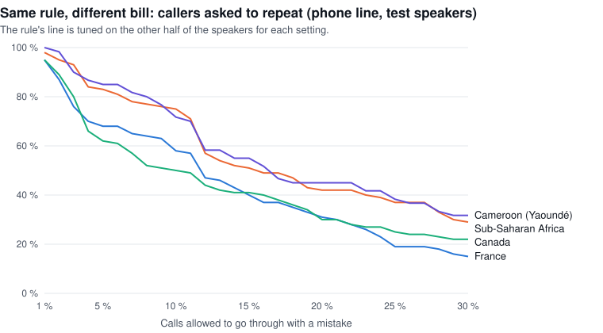

# Who pays for the correction?

**Track:** Languages
**Team:** Haris Folas

**In one sentence:** with one "please repeat" rule for every caller, African-accented callers were asked to repeat more often than callers from France in all 8 versions of the test (4 of them significant on their own), with a similar but unproven gap even when Whisper had heard them right; the two fixes I tested help, but neither closes the gap.

**Interactive results page:** https://dicsio100-dev.github.io/who-pays-for-the-correction/ · **Every number in detail:** [`FINDINGS.md`](FINDINGS.md)

## The problem

AI phone agents now answer calls for small businesses and say "Sorry, could you repeat that?" whenever the speech recognizer is unsure, with one line set for every caller. In Québec, Cameroon was the top country of birth of new immigrants in 2024 (15.4 %), and 47 % of daily French speakers live in Sub-Saharan Africa and the Indian Ocean, yet only 0.23 % of French Common Voice recordings carry that accent. If the recognizer hears some accents worse, those callers pay for the safety rule with their time.

## What we built

A fairness check for a phone agent's "please repeat" rule. **In:** recordings with their true text, grouped by accent, and the business's safety setting (how many calls may go through with a mistake). **Out:** per accent, the share of words Whisper gets wrong, of callers asked to repeat, and of mistakes that slip through, each with a 95 % range. A local demo shows it live on one sentence.

## What we added

Started from suggested project 4.4.3 (speech recognition across accents). Added our own **question** (who is asked to repeat under the same rule: prior work names this burden but has not measured it on real speech, Choi & Choi 2025, Ethiraj & David 2026), our own **setting** (a simulated phone line, 300–3,400 Hz, 8 kHz G.711), a **second corpus** (30 speakers from Yaoundé, Cameroon, OpenSLR 57) and **two fixes**.

## How it works

**Data:** Common Voice French 27.0, 50 speakers per accent (France, Canada, Sub-Saharan Africa, as each speaker declared), 4 sentences each, plus 30 Yaoundé speakers: 720 clips. Text normalised the same way on both sides. Speakers split in half before looking at results: the rule's line is tuned on one half and judged on the other, then the halves swap.
**Model:** Whisper large-v3 through Groq, a widely used open model; large-v3-turbo on a laptop for word-by-word confidence. Word error rate with jiwer; 95 % ranges and two-sided p-values from 1,000 resamples of speakers.

## Results

1. **Errors.** Whisper gets 1.5 to 1.7 times as many words wrong for Canadian (12.3 %) and Sub-Saharan African speakers (10.7 %) as for France (7.3 %) on normal audio (p = 0.006 and 0.028), as Nieto et al. found on podcasts (Interspeech 2026). The gap stays without sentences containing names and in the cleaner half of the recordings (smaller there for Sub-Saharan Africa).
2. **Phone line.** It widens the gap for Common Voice's Sub-Saharan African speakers only: +3.9 points of errors against +0.7 for France (difference 3.2, 95 % range 1.2 to 5.3, p = 0.002), not for Canada (p = 0.43) or Yaoundé (p = 0.76).
3. **Same rule, different bill (the weakest result).** On the phone line, the rule asks 87 % of Sub-Saharan African callers to repeat against 77 % for France (p = 0.052), and 89 % of Yaoundé callers (p = 0.008); Canadians are not asked more. All 8 versions (2 African groups × 2 audio types × 2 halves) point the same way, by 8 to 17 calls in 100, and 4 are significant on their own; they share speakers. Whisper's extra mistakes explain only about 1 to 4 of those points (a rough split, without a range); the rest comes from lower confidence scores on African-accented speech, on correct and misheard sentences alike. **Among sentences Whisper heard correctly**, they are still asked more in all 8 versions (80 % against 72 % on the phone line), but no gap is significant on its own (p ≥ 0.19): a hint, not a proof, that the rule costs them more at equal error.

**Against the baseline:** the line is tuned so that 5 % of calls slip through on the speakers it is tuned on (6 to 8 % on the others; 13 % for Canada on the phone test half, a gap that could be chance). Never asking lets 49 % of calls through with a mistake; asking the same share at random (73 %) lets 13 % through; the rule lets 8 %. Whisper's score is a weak alarm (it ranks a correct sentence above a misheard one only 62 to 80 % of the time), so most callers are asked to repeat.

**The two fixes.** Telling Whisper "this is French" (left to guess, it picked another language for 9 of 100 African-accented calls and 7 Canadian ones, against 2 for France) narrows the gap by 2.9 points for Canada (p = 0.012) and 1.3 for Sub-Saharan Africa (p = 0.058); results 1–3 use it. Confirming only the doubtful words (large-v3-turbo, test speakers) cuts the words re-said by 24 to 39 % in every group, but the Sub-Saharan African gap stays (+2.25 words per call before, +2.21 after; change −1.0 to +1.2) and grows for Canada (not significant), while 96–100 % of calls now get a question. Both help, with fewer errors or fewer words re-said; neither makes it fair.

**Where it fails** (normal audio, word for word):

| Speaker | Read | Whisper wrote |
|---|---|---|
| France | En fait, il ne s’agit que d’une ruse de Kęstutis pour gagner du temps. | En fait, il ne s'agit que d'une ruse, mais qu'est-ce que tu utilises pour gagner du temps ? |
| Sub-Saharan Africa | L’oiseau le plus lent. | Loiseau de Poulain |
| Sub-Saharan Africa | Zengi retourne alors assiéger Homs. | Réalisé par Neo035 (an invented subtitle credit, once in 1,440 transcriptions) |

Names and numbers fail for every accent: Whisper gets 29 to 43 % of them wrong in each Common Voice group, with no significant gap (p ≥ 0.14; measure added after the first look), so an agent should always confirm names. **Checked by ear:** I listened to 20 clips (5 per group); the text matched the speech in 18, and the counting slips I found appear in every group.

## What we'd do next

Test on real calls (with permission) and separate African countries. Neither fix closes the gap, which points to the recognizer itself: more African-accented French in training data (Common Voice has 1,846 such clips out of 792,011). Not tested here.

## Limits

50 speakers per group (25 per half; Yaoundé 30): enough to see error gaps of about 3 points, but repeat gaps only of about 10. Read Wikipedia sentences (Yaoundé: proverbs), not real calls. A repeated sentence is assumed to be heard correctly. Whisper's training data is not public, so it may include some of these recordings. Choices made after the first look are listed in `FINDINGS.md`; some made results weaker, some stronger, and both versions are reported.

## Sources

- Mozilla Common Voice Scripted Speech 27.0 – French, Mozilla Data Collective (CC0; audio not redistributed, as the terms require): https://mozilladatacollective.com/datasets/cmu5kub4600pkmh078n7n5ogl
- OpenSLR 57, African Accented French (Apache 2.0; Yaoundé part recorded in 2003 by the U.S. Military Academy's CTELL): https://www.openslr.org/57/
- Whisper large-v3 (OpenAI): https://huggingface.co/openai/whisper-large-v3, run through the Groq API: https://console.groq.com/docs/speech-to-text
- faster-whisper (SYSTRAN): https://github.com/SYSTRAN/faster-whisper, with Whisper large-v3-turbo: https://huggingface.co/mobiuslabsgmbh/faster-whisper-large-v3-turbo and Whisper small: https://huggingface.co/Systran/faster-whisper-small (tried first, too weak on phone audio)
- jiwer: https://github.com/jitsi/jiwer · text2num: https://github.com/allo-media/text2num · numpy: https://numpy.org · soundfile: https://github.com/bastibe/python-soundfile · requests: https://github.com/psf/requests · ffmpeg (audio conversion, phone line): https://ffmpeg.org
- Nieto, Angelika-Nikita, Sarkis & Yang, *Dialect Bias in Speech Recognition Across 10 Spanish and French Varieties*, Interspeech 2026: https://www.isca-archive.org/interspeech_2026/nieto26_interspeech.pdf
- Institut de la statistique du Québec, immigrants by country of birth (2024p): https://statistique.quebec.ca/fr/document/migrations-internationales-interprovinciales-quebec/tableau/immigrants-selon-le-pays-de-naissance-quebec
- OIF, *La langue française dans le monde 2022*, synthesis p. 7: https://www.francophonie.org/sites/default/files/2022-03/Synthese_La_langue_francaise_dans_le_monde_2022.pdf
- Prior work on the burden of repeating: Choi & Choi 2025 (https://arxiv.org/abs/2508.07143), Ethiraj & David 2026 (https://arxiv.org/abs/2609.04206); targeted clarification in dialogue systems (Stoyanchev et al., SIGDIAL 2013–2014).
- **AI tools used:** Claude Code (Anthropic, https://claude.com/claude-code), as a coding and writing assistant for the analysis code and this write-up. I chose the question, which comes from my own work building phone agents, and listened to 20 clips to check the data and the errors. Whisper models as listed above.

## Run it yourself

Python 3.12, ffmpeg, `pip install -r requirements.txt`. Download Common Voice French 27.0 from Mozilla Data Collective (free account, accept the terms) and OpenSLR 57. Set `MDC_API_KEY` and `GROQ_API_KEY` in your environment (data goes to `~/veritas-data`, or `$VERITAS_DATA`). Then, in `code/`:
1. `cv_extract.py` (Common Voice clips, streamed, nothing else kept) and `prepare.py yaounde`;
2. `transcribe_groq.py clean`, `transcribe_groq.py phone`, `transcribe_groq.py phone --split test --source commonvoice27_fr --auto-language --tag autolang` (Whisper guessing the language, for fix 1), `transcribe_local.py phone --model turbo --beam 1`;
3. `analyze.py`, `checks.py`, `language_hint.py`, `key_info.py`, `policy_words.py phone turbo`;
4. `export_site.py` and `make_figures.py` (page data in `docs/`, figures). Demo: `python demo/server.py`, then open http://127.0.0.1:8770.
Each script explains its own usage at the top.
