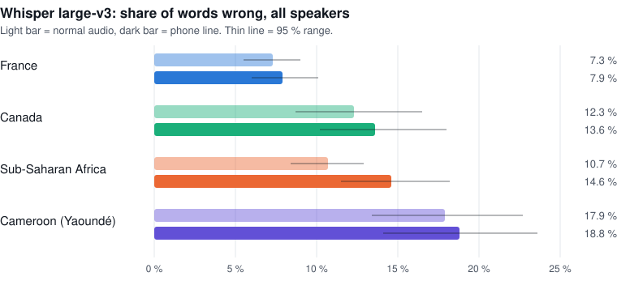

# Who pays for the correction?

**Track:** Languages
**Team:** Haris Folas

**In one sentence:** when an AI phone agent asks callers to repeat themselves whenever Whisper is unsure, the same rule makes callers with an African French accent repeat more often, because Whisper mishears them about twice as often and a phone line makes it worse.

**Interactive results page:** https://dicsio100-dev.github.io/who-pays-for-the-correction/ · **Numbers behind every claim:** [`FINDINGS.md`](FINDINGS.md)

## The problem

AI phone agents now answer calls for small businesses. When the speech recognizer is not sure what it heard, the agent says "Sorry, could you repeat that?". The line that decides is set once, for every caller. In Québec, Cameroon was the top country of birth of new immigrants in 2024 (15.4 %), and 47 % of people who speak French every day live in Sub-Saharan Africa, yet only 0.23 % of French Common Voice recordings carry that accent. If the recognizer hears some accents worse, those callers pay for the safety rule with their time.

## What we built

A fairness check for a phone agent's "please repeat" rule. **In:** recordings with their true text, grouped by accent, plus the business's safety setting (how many calls may go through with a mistake). **Out:** for each accent, the share of words Whisper gets wrong, the share of callers asked to repeat, and the share of mistakes that slip through, each with a 95 % range. A business runs it before going live to see who pays. A local demo shows the same thing live: say a sentence, see the doubtful words and what the agent would answer.

## What we added

Started from suggested project 4.4.3 (speech recognition across accents). Added:
- **Our own question:** not just "which accent has more errors" but "who is asked to repeat under the same rule", measured instead of only proposed (prior work proposes repeat burden as a fairness metric but reports no measurements on real speech).
- **Our own setting:** every clip also through a simulated phone line (300–3,400 Hz, 8 kHz G.711), because that is what a phone agent actually hears.
- **Our own data:** 30 speakers recorded in Yaoundé, Cameroon (OpenSLR 57) as a separate check.
- **Two fixes tested:** telling Whisper the language, and confirming only the doubtful words.

## How it works

**Data:** Mozilla Common Voice French 27.0, 50 speakers per accent group (France, Canada, Sub-Saharan Africa, as each speaker declared), 4 sentences each (600 clips), plus 30 Yaoundé speakers (120 clips). Text normalised the same way on both sides (lowercase, numbers as digits, no accents or punctuation). Speakers split in half before looking at results: the rule's line is tuned on one half and judged on the other, then the halves swap.
**Model:** Whisper large-v3 (through Groq) for the main measurements, because it is what most agents use; Whisper small and large-v3-turbo on a laptop CPU for word-by-word confidence. Word error rate with jiwer; 95 % ranges and two-sided p-values from 1,000 resamples of speakers (not clips).

## Results

1. **Whisper gets about twice as many words wrong** for Canadian (12.3 %) and Sub-Saharan African French (10.7 %) as for France (7.3 %), all speakers, normal audio (gaps p = 0.006 and 0.028). This repeats, on a different dataset, what Nieto et al. found on podcasts (Interspeech 2026). It holds without sentences containing names, with clean recordings only, and at equal sentence length.
2. **A phone line widens the gap for Sub-Saharan African speakers:** +3.9 points of errors against +0.7 for France, so the gap grows by 3.2 points (95 % range 1.2 to 5.3, p = 0.002). Not for Canada (p = 0.43) or Yaoundé (p = 0.76).
3. **Same rule, different bill.** Allowing at most 5 % of calls through with a mistake, the rule asks 83 % of Sub-Saharan African callers to repeat against 68 % for France (phone, test speakers). African-accented callers are asked more in all 8 versions of this comparison (both African groups, both audio types, both halves), by 8 to 17 calls out of 100; 4 of the 8 are significant on their own.

**Against the baseline:** never asking lets 49 % of calls through with a mistake; asking the same share of callers at random (73 %) would let 13 % through; the confidence rule lets 8 % through. Whisper's score helps, but it is a weak alarm: it ranks a correctly heard sentence above a misheard one only 62 % (France) to 72 % (Sub-Saharan Africa) of the time, which is why the rule asks most callers to repeat.

**Fix 1, telling Whisper "this is French":** without it, Whisper guessed the wrong language for 9 % of African and 7 % of Canadian callers against 2 % for France, sometimes translating them into English. With it, the gap with France shrinks by 2.9 points for Canada (p = 0.012) and 1.3 points for Sub-Saharan Africa (p = 0.058). Results 1–3 already use this fix.

**Checked by ear:** I listened to 20 clips (5 per group). The text matched the speech in 18 (one typo in the dataset, one Yaoundé speaker who read a different word); in 8 of the 12 clips with counted errors, every counted error was a real Whisper mistake. Such slips appear in every group, so they add noise but do not explain the gap.

**Where it fails:** names. Whisper gets about one name in three wrong for every accent (Wikipedia names such as "Kestutis" or "Mugla"), so a phone agent should always confirm names, whoever calls. It also invented a sentence once ("Réalisé par neo035", a subtitle credit) out of 1,440 transcriptions.

## What we'd do next

- Test on real calls (with permission) instead of a simulated phone line, and separate African countries instead of one pooled group.
- The gap comes from Whisper's decoder (Nieto et al.): the real fix is more African-accented French in training data. Common Voice has 1,846 such clips out of 792,011.

## Limits

50 speakers per group (25 per half), so gaps under about 5 points are not resolvable. People read Wikipedia sentences; they were not calling a business. A repeated sentence is assumed to be heard correctly. Several choices were made after the first look and are listed in `FINDINGS.md` (all of them made results more cautious).

## Sources

- Mozilla Common Voice Scripted Speech 27.0 – French, Mozilla Data Collective (CC0; audio not redistributed, as the terms require): https://mozilladatacollective.com/datasets/cmu5kub4600pkmh078n7n5ogl
- OpenSLR 57, African Accented French: https://www.openslr.org/57/
- Whisper large-v3 (OpenAI) through the Groq API; faster-whisper small and large-v3-turbo (SYSTRAN, mobiuslabsgmbh); jiwer; text2num.
- Nieto, Angelika-Nikita, Sarkis & Yang, *Dialect Bias in Speech Recognition Across 10 Spanish and French Varieties*, Interspeech 2026: https://www.isca-archive.org/interspeech_2026/nieto26_interspeech.pdf
- Institut de la statistique du Québec, immigrants by country of birth (2024p); OIF, *La langue française dans le monde 2022*, synthesis p. 7.
- Prior work on repair burden: Choi & Choi 2025 (arXiv 2508.07143), Ethiraj & David 2026 (arXiv 2609.04206); targeted clarification in dialogue systems (Stoyanchev et al., SIGDIAL 2013–2014).
- **AI tools used:** Claude Code (Anthropic) to help write and check the analysis code and this page; Whisper models as listed above.

## Run it yourself

Python 3.12, ffmpeg, `pip install -r requirements.txt`. Download Common Voice French 27.0 from Mozilla Data Collective (free account, accept the terms) and OpenSLR 57. Set `MDC_API_KEY` and `GROQ_API_KEY` in your environment (data goes to `~/veritas-data`, or `$VERITAS_DATA`). Then, in `code/`:
1. `cv_extract.py` (Common Voice clips, streamed, nothing else kept) and `prepare.py yaounde`;
2. `transcribe_groq.py clean`, `transcribe_groq.py phone`, `transcribe_local.py phone --model turbo --beam 1`;
3. `analyze.py`, `checks.py`, `language_hint.py`, `key_info.py`, `policy_words.py phone turbo`;
4. `export_site.py` and `make_figures.py` (page data and figures). Demo: `python demo/server.py`.
Each script explains its own usage at the top.
